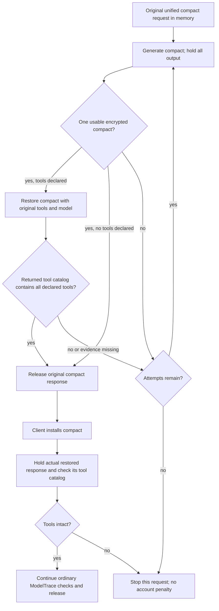

# Native Lite compact tool check

The CPA Codex HTTP executor validates tool restoration independently of ModelTrace.
It applies to native Responses Lite on `/v1/responses`, with either OAuth or API-key
auth. It does not identify or disable an upstream account. The plugin API/ABI is
unchanged. Legacy `/responses/compact` and upstream WebSocket execution are outside
this check.



The retry resends the **original compact request**, not the ordinary generation
request and not the rejected encrypted compact. The request body stays in memory
through this loop. Physical session and parent HTTP/2 pool stay unchanged. There
is no session rotation or socket-pool reset for a compact tool failure.

For remote compaction v2, Codex counts only `response.output_item.done` events
before the first `response.completed` event. Exactly one item must have type
`compaction` (or its wire alias `compaction_summary`) and string encrypted content.
Other items, such as reasoning, can appear beside it. `context_compaction` is a
different item and does not satisfy this count. A compaction item present only in
the terminal response's `output` array does not satisfy Codex either.

CPA checks the same event stream before release. Zero or multiple compaction
items, a missing item event, or invalid encrypted content trigger a retry of the
original request. This prevents Codex's fatal `expected exactly one compaction
output item, got 0 from 2 output items` error. It does not establish which gateway
produced the invalid stream; that requires the corresponding raw upstream dump.

The private restoration request uses a separate HTTP/1.1 connection, the same
model and reasoning effort, the original tool declarations and developer/system
context, the new encrypted compact, and a short request to reply `OK`. It excludes
old calls/results and compact-generation controls. It never executes a tool or
releases its output to the client. Its state token cannot replace the original
compact response's token.

The check compares namespace-qualified names and tool kinds. It reads
`response.created.tools` or `response.in_progress.tools` when an array is present,
then cancels only the private request. If these events omit the catalog, it waits
for `response.completed.tools`. It does not ask the model to report its own tools.
An ordinary text answer with all tools available passes. Empty, partial, malformed
or missing catalog evidence does not authorize release. Extra server tools are
allowed. Cache counts, attribution, state and fingerprint scores cannot substitute
for tool availability. This check does not establish model identity or cache trust.

Early cancellation reduces generated output but does not guarantee zero inference
or zero cost. A cheaper model cannot authorize restoration for the requested model.
The initial compact response's tool catalog describes its input, so it cannot prove
that the newly created compact restores those tools. A separate restoration request
is required before releasing that compact.

```yaml
upstream:
  codex:
    compact-tool-check: true
    compact-max-attempts: 5
```

The tool catalog check defaults to enabled. Setting `compact-tool-check: false`
disables that check, but generated compact output still must pass the event check.
The attempt count includes the initial compact
generation; zero uses 5, and the maximum is 16. This budget belongs to one host
compact execution. It is separate from ModelTrace's thread/hour retry budget and
Codex's own transport retries. Missing tools or catalog evidence, invalid compact
output, transient 5xx and incomplete/failed transport can retry while held. Ordinary
4xx, cancellation and local size/capacity failures do not spend further attempts.
Exhaustion returns a request-scoped error, which stops native account reselection.
The bound plugin callbacks preserve that stop as an error, rather than converting
it into a model failure that could create a thread exclusion.

An already installed compact cannot be repaired by repeating ordinary generation.
Its response still gets the tool check, but CPA does not replay that ordinary
request or silently replace the client's history. Recovery requires the original
precompact input. That input is retained during the guarded compact operation;
this change does not create a persistent archive of older request bodies.

At most eight checks hold responses concurrently. Each stream is bounded by 8 MiB
and 65,536 chunks. A terminal stream is required before releasing parent output.
Cancellation closes the active stream. Probe cancellation does not close the
parent HTTP/2 connection. Existing request logs and raw dumps record upstream calls.

Validation covers real TLS HTTP/2 parent reuse, a separate HTTP/1.1 probe, replay
of identical compact input, unchanged model/effort/session, early metadata without
an answer, terminal fallback, exhaustion, cancellation, local overflow, nonstream
Responses, configuration scope and plugin error propagation. The reusable process
E2E script is `cpa-modeltrace/tests/e2e/compact_guard.py`; it starts the real CPA
binary against a loopback upstream, with plugins disabled and no paid calls.
Its output cases include zero compaction items among two outputs, terminal-only
output, a conflicting terminal array, valid extra items, and Lite terminal output
that omits items already delivered through `output_item.done`.

Validation on 2026-10-21: all nine process E2E cases passed using an isolated
server built from the current patch manifest. All 135 patches applied cleanly
to the pinned upstream and produced tree
`ba10387c4e0e5bb70609f6c6f513439f26a75366`. These checks use a loopback upstream;
they do not attribute the reported production error to a specific gateway.

The subsequent ABI test fixture correction adds original item IDs and matching
attribution to its held fake response. The real shared-library test now reaches
the intended replay-disabled boundary after one callback. It also checks PAYG
registration and reuse. That test passed with native hold enabled. The current
fixture-validation tree is `cda67a8488308030b7d168cab225cb6d0b57d908`; that difference
changes only the fixture, not the compact runtime.
